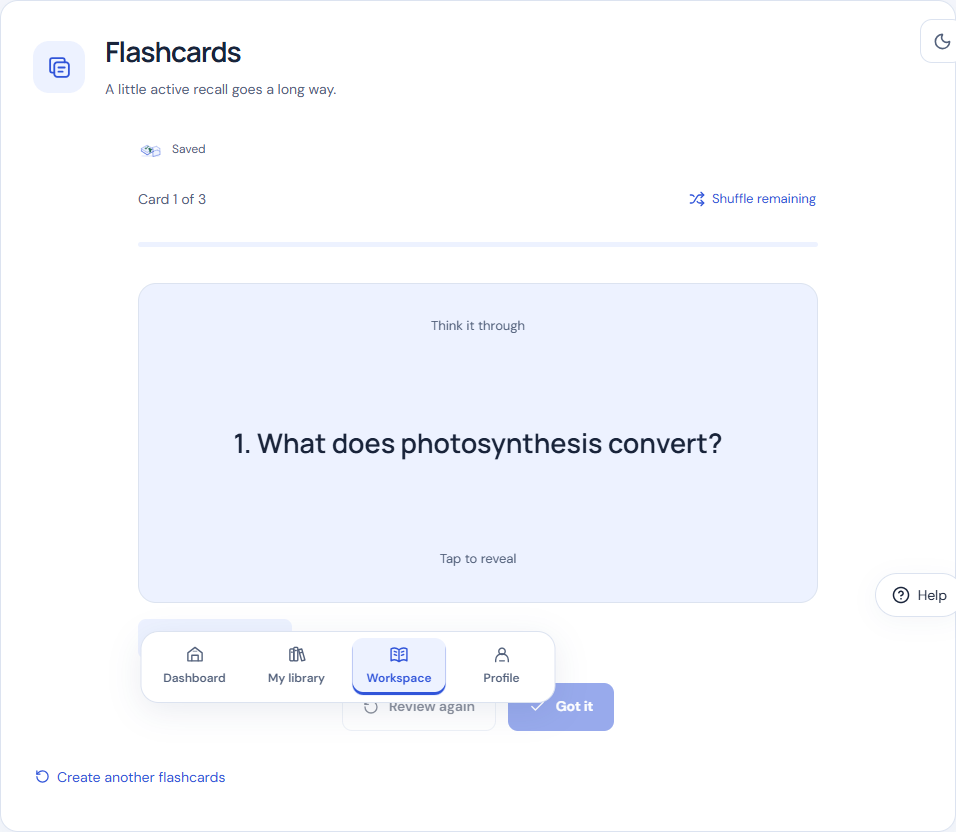

# ASKLearn

A student learning workspace: upload your materials, ask questions with source citations, and create summaries, reviewers, flashcards, quizzes, and timed practice tests.

Built from `ASKLearn_Build_Guide.md` and `ASKLearn_MASTER_PROMPT.md`. This implementation uses student accounts instead of anonymous browser IDs, Gemini or OpenRouter instead of Anthropic, and server-side assessment scoring. The guides remain reference documents; their example code and environment variables are not the application's setup instructions.

ASKLearn uses a Cobalt & Porcelain workspace with DM Sans reading text, Manrope headings, an original 2D student with expressive poses and 3D book/folder scenes, a skippable ten-second sign-in welcome, and step-by-step spotlight guides saved to each account. Searchable learning history, profile settings, restrained home scroll effects and database-backed study resume remain available. See the [student guide and intro instructions](docs/student-guide.md), [design decisions](docs/design.md), and [generated artwork](docs/cobalt-generated-assets.md). The [online pilot guide](docs/online-pilot.md) explains the prepared Render + Neon deployment and migration of local records. A cloud URL is available only after deployment is completed.



*Actual interface with a sample lesson and deterministic demonstration output.*

## Requirements

- Python 3.13 or 3.14 (this workspace was verified with Python 3.14).
- Node.js 22.12+ (verified with Node 24).
- Internet and a Gemini or OpenRouter API key for AI features. Both can be configured together; Gemini is primary by default with OpenRouter as backup. See the [provider setup guide](docs/ai-providers.md). Account and library operations work without a key.

## Setup on Windows

Run from the repository root in PowerShell:

```powershell
python -m venv .venv
.venv\Scripts\python.exe -m pip install -r backend/requirements.txt
Copy-Item backend/.env.example backend/.env
cd frontend
npm.cmd ci
npm.cmd run build
cd ..
.venv\Scripts\python.exe -m uvicorn backend.app.main:app --host 127.0.0.1 --port 8000
```

Open **http://127.0.0.1:8000**. For subsequent launches, double-click **Start ASKLearn.cmd**. The launcher runs the built frontend and API on one local origin and keeps the server console open for shutdown with Ctrl+C.

## Setup on macOS / Linux

```bash
python3 -m venv .venv
.venv/bin/python -m pip install -r backend/requirements.txt
cp backend/.env.example backend/.env
cd frontend
npm ci
npm run build
cd ..
.venv/bin/python -m uvicorn backend.app.main:app --host 127.0.0.1 --port 8000
```

For frontend development, run the API command above and `npm run dev` in `frontend` in another terminal. Open the Vite URL (normally http://127.0.0.1:5173). Vite proxies `/api` to the local backend, preserving the origin for cookie authentication and CSRF checks.

## Gemini free-tier configuration

Create your own key at [Google AI Studio](https://aistudio.google.com/api-keys). Put it only in `backend/.env`:

```dotenv
GEMINI_API_KEY=your_key_here
GEMINI_MODEL=gemini-3.1-flash-lite
```

Restart the API after changing configuration. Do not put the key in the frontend, screenshots, Git, or chat messages. No provider account is created or billing enabled by this project.

Google lists a free tier for the default model, subject to project/model quotas and availability. Free-tier content can be used to improve Google's products. Use material suitable for those terms; a private ASKLearn account does not make the AI provider's processing private. Check [current pricing](https://ai.google.dev/gemini-api/docs/pricing), [terms](https://ai.google.dev/gemini-api/terms), and [your limits](https://aistudio.google.com/rate-limit) before a demo. The application does not automatically switch providers or paid models. Whether requests are billed depends on your Google project and configuration.

Other settings in `backend/.env.example`: database URL, maximum upload size, extracted character limit, and secure-cookie setting. Defaults: 15 MB upload, 500,000 extracted characters, 900-character chunks with 150-character overlap, six chat passages, 60,000-character generator context budget. DOCX/PPTX expanded archives are limited to 50 MB; PDFs to 500 pages. Local runs use non-Secure cookies over loopback HTTP; public HTTPS deployment must enable `COOKIE_SECURE=true`.

## Using ASKLearn

1. Create a student account with a name, email, and password of at least 10 characters.
2. Upload PDF, DOCX, PPTX, UTF-8 TXT, or Markdown. Select up to 20 materials and open the workspace.
3. Ask a question. Open the source chips to inspect the supporting passage. Follow-up chat uses the last eight complete messages; it is not independent evidence.
4. Generate any study tool. Summary/reviewer export as Markdown. Flip flashcards and mark what needs review.
5. Answer quizzes with immediate feedback. Practice tests use all three question types and at least 20 questions. Start a timer, save answers, and submit for server-scored results. The sidebar lets you reopen saved study tools and past attempts.
6. Rename/delete a material in the Library. Deleting a material also removes all conversations, sets, and attempts that reference it (including sets combining several files). “Delete my learning data” removes all learning records while retaining the account.

After signing in, **Dashboard** offers “Continue learning” and a searchable history of your own materials, conversations, tools, and assessments. The profile link beside your name opens avatar/companion preferences and password settings. Password changes require the current password and sign you out on all devices; verification/recovery email is intentionally not included in this pilot.

The workspace remembers selected lessons, study tab, conversation, and generated tool. Flashcards retain the current card, flip state, shuffled order, and review marks; assessments retain their question position and saved answers. Check **Saved** or **Answers saved** before leaving. An offline/unacknowledged change is not guaranteed to survive closing the browser. Normal navigation and logout flush pending saves, while a conflict from another device offers **Load latest** rather than silently overwriting it.

Uploads show actual transfer percentage, then an indeterminate **Processing material** stage, followed by **Saved to your library** only after the server confirms persistence. The illustrated companion responds to real task states, can be minimized/hidden, and respects reduced motion. It is not a human tutor or a separate AI service.

Practice-test answer keys and explanations are not sent before submission. The server stores the deadline; refreshes do not restart it. An expired attempt is finalized when the client timer fires or the server next receives an attempt request. Identification scoring ignores surrounding whitespace and letter case; synonyms are not automatically accepted.

## Tests

```powershell
New-Item -ItemType Directory -Force artifacts | Out-Null
.venv\Scripts\python.exe -m pytest backend/tests -q --basetemp=artifacts/pytest-local
cd frontend
npm.cmd run build
npm.cmd run test:e2e
```

Browser tests use installed Microsoft Edge (`channel: msedge`), deterministic AI fixtures, an isolated SQLite database, and port 8001. On systems without Edge, install Edge or change the Playwright channel to an installed Chromium browser. On Linux CI, the workflow installs Chromium. The normal launcher never enables test fixtures. For repeated runs, choose a fresh pytest `--basetemp` if Windows denies cleanup of an old directory.

Test-server data lives under `artifacts/` and is ignored by Git. Backend tests use fresh in-memory databases. Screenshots are stored in `artifacts/`. The four public tour screenshots show the actual interface with **sample biology material and deterministic test output**, not measured accuracy or real student data.

`docs/test_log.csv` and `docs/evaluation_template.md` are blank evaluation instruments. Fill them with your actual observations, accuracy checks, usability responses, and timings. `docs/verification.md` records developer checks and their boundaries.

## Architecture and API

The built React frontend is served by FastAPI; no external database is required. SQLite stores accounts, revocable login sessions, document metadata/chunks, conversations/messages, study sets, and assessment attempts. All private queries enforce authenticated ownership. Session tokens are stored hashed in the database; passwords use Argon2. Mutating authenticated requests require `X-CSRF-Token`, returned by login or `/api/auth/me`. Cookies are HttpOnly and SameSite=Strict.

Interactive API schema: `/docs`. Main routes:

| Routes | Purpose |
|---|---|
| `GET /api/health` | Server and AI configuration status (does not call Gemini) |
| `POST /api/auth/register`, `/login`, `/logout`; `GET /api/auth/me` | Accounts and cookie sessions |
| `GET/PATCH /api/profile`; `POST /api/auth/change-password` | Name, preset avatar, companion preference, authenticated password change |
| `GET/PUT /api/workspace`; `GET/PUT /api/study-sets/{id}/progress` | Versioned account-owned resume state; stale writes return 409 |
| `GET /api/history?q=&type=&offset=&limit=` | Searchable, filtered, paginated learning history and real account counts |
| `POST/GET /api/documents`; `PATCH/DELETE /api/documents/{id}` | Material upload, listing, rename, deletion |
| `POST /api/chat`; `GET /api/chats`, `/api/chats/{id}` | Cited streaming chat and saved conversations |
| `POST /api/generate`; `GET /api/study-sets`, `/api/study-sets/{id}` | Five validated generators and saved sets |
| `POST/GET /api/attempts`; `GET /api/attempts/{id}` | Start/resume and assessment history |
| `PUT /api/attempts/{id}/answers`; `POST /api/attempts/{id}/submit` | Save answers and code-based grading |
| `DELETE /api/data` | Delete the signed-in student's learning data |

Chat is a POST SSE stream: `meta` (chat ID), `sources` (source ID/file/location/excerpt/document ID), unnamed JSON string token events, `error`, and `done` (completion status). Incomplete/error answers are marked in history. Source IDs are checked for references outside the retrieved set; content correctness still requires human evaluation.

Retrieval uses BM25Plus rather than the guides' BM25Okapi because Okapi can return zero or negative scores for relevant terms in a tiny corpus. An unmatched broad question uses evenly distributed lesson passages. Generation samples long documents, so coverage can be partial. All prompts live in `backend/app/prompts.py`; provider calls live in `llm.py`.

## Privacy and limitations

- Raw uploaded files are removed after extraction, including on extraction failure. Extracted text and excerpts remain in SQLite until deleted. Back up the database only with the students' permission.
- PDFs use page numbers; PPTX uses slide numbers. DOCX/TXT/MD use location 1 because faithful pagination is unavailable. Images, scanned PDFs, OCR, diagrams, complex formulas, and advanced document layouts are unsupported or incomplete.
- AI can produce incorrect or incomplete explanations despite citations and structured validation. Source references prove which passages were supplied, not factual correctness.
- English interface; no teacher dashboard, email verification, password recovery, or paid production hosting is included. Free-pilot deployment manifests are provided, but a manifest alone is not a deployed service.
- This is a local, single-process school-project deployment. In-memory rate limiting is not distributed. Public hosting needs HTTPS, secure cookies, reverse-proxy configuration, shared quotas, backups, and deployment-specific testing.
- Remote cross-device access requires hosting the same backend/database. Accounts persist locally between launches; GitHub stores source code, not your student records.

Local SQLite upgrades back up the existing database into `backend/.backups/` before numbered additive migrations. Cloud mode uses a managed Postgres URL, secure cookies, and a trusted HTTPS origin; startup rejects ephemeral SQLite storage. See the pilot guide before copying any student data or changing deployment configuration.

## Troubleshooting

- **Server not reachable:** start Uvicorn from the repository root and check port 8000 is free.
- **AI needs a key:** add `GEMINI_API_KEY` to `backend/.env` and restart; verify the model is available to your project.
- **Quota reached:** wait for your project's quota reset. Do not repeatedly press Retry or enable billing just to bypass a demo error.
- **No readable text:** upload a selectable-text document, not a scan or image.
- **npm cache permissions:** the repository's `.npmrc` uses a project-local cache. Use `npm.cmd` in PowerShell if script execution policy blocks `npm.ps1`.
- **Browser API fails after changing ports:** use the documented Vite proxy or the combined built app; arbitrary cross-origin frontends are intentionally rejected.
- **GitHub push denied:** authenticate Git Credential Manager with an account that has write access to this repository. Never place a token in the remote URL.

## Publish to your GitHub repository

Double-click **Publish ASKLearn.cmd** from your normal Windows session. It checks the exact origin URL and branch, fetches remote references, stages the source paths above, commits changes, and pushes `main` to [midddddiana24/ASKLEARN](https://github.com/midddddiana24/ASKLEARN). Git Credential Manager may ask you to sign in. It stops on errors and never force-pushes. If the remote has new history, integrate that history before retrying.

The coding session could initialize the repository and configure `origin`, but its `.git` directory is read-only: `git add` failed while creating `.git/index.lock`. Therefore this delivery has not been committed or pushed from that session. The publish script is provided for execution outside that restricted session; its real push path has not been run here.
